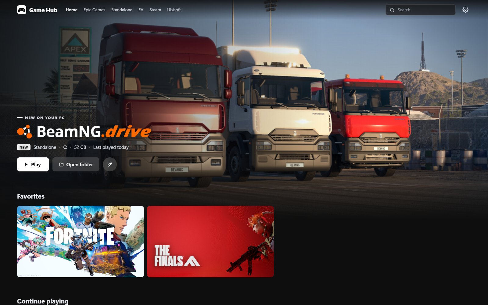

# Changelog

All notable changes to Game Hub are documented here.

The format is based on [Keep a Changelog](https://keepachangelog.com/en/1.1.0/), and the project uses [Semantic Versioning](https://semver.org/spec/v2.0.0.html). Until a 2.0 release, the [HTTP API](docs/api.md) is internal and may change in minor versions; such changes are called out here.

## [Unreleased]

## [1.1.0] - 2026-11-24



**Every game on your PC, in one place.** This is the first public release of Game Hub.

I build tools I want to use. My games were spread over Steam, Epic, EA, Ubisoft and a few folders of their own. Every launcher showed only its share, and a launcher reinstall could quietly forget games that were still on the disk. Game Hub finds all of them, shows them with their real cover art like a streaming app, and starts any of them with one click, through its own launcher when it has one. It runs on your PC, needs no account and sends nothing about you anywhere.

Version 1.0.0 was the first build, and only I used it. Everything that came after is listed below. New here? Start with *What to expect*.

### 🧭 What to expect

- 🎮 **Every launcher in one library.** Steam, Epic Games, EA app, Ubisoft Connect, GOG Galaxy, Battle.net, Riot, Amazon Games, Rockstar and the Xbox app (Microsoft Store and PC Game Pass), plus standalone games in folders you choose. Games a launcher forgot after a reinstall still show up: Game Hub finds them from their own files.
- 🖼️ **A home page that feels like a streaming app.** A large billboard that moves through your games, then Favorites, Continue playing, Most played, Recently added and one row per launcher, all with official cover art. Upload your own art for anything that has none.
- ⏱️ **Play time.** Every game you start from Game Hub records its sessions, and Steam's own play time is imported, so your history starts full.
- 🕹️ **Made for the couch too.** DualSense, DualShock 4 and Xbox controllers drive the whole hub, with an on-screen keyboard for search. Hold View + Menu anywhere in Windows to bring Game Hub back. If you use DS4Windows, Game Hub suggests which games need it and switches it game by game.
- 🪟 **It gets out of the way.** Game Hub minimizes once the game's window opens and comes back when you quit.
- 💾 **Your data stays yours.** Settings, library, favorites and play time live in `%LOCALAPPDATA%\GameHub`, with daily backups you can restore from Settings. Game files are never moved, changed or deleted.
- 🌍 **11 languages.** English, French, Spanish, Portuguese (Brazil), German, Russian, Simplified Chinese, Japanese, Korean, Polish and Turkish. The ten translations were made with an AI, and Settings links to a form to report a wrong one.

### 📋 Before you install

- 💻 **Windows 10 or 11,** with Windows PowerShell 5.1, which is part of Windows. No administrator rights, no installer, no Windows service, no registry changes.
- 🌐 **Google Chrome or Microsoft Edge** for the app window. Edge comes with Windows.
- 📡 **What goes online:** artwork lookups (game titles and store ids, sent to Steam's store and image servers, Epic's image servers and the Microsoft Store catalog) and, only when you press **Check my games**, controller lookups on PCGamingWiki and Steam. Nothing else, and no telemetry. [Privacy](https://github.com/izored/gamehub#privacy) lists every call.
- 🛡️ **Antivirus.** Game Hub is a set of PowerShell scripts that run without a window, and some antivirus products question that. Never turn your protection off for it: [Troubleshooting](https://github.com/izored/gamehub/blob/main/docs/troubleshooting.md#the-hub-doesnt-open-or-the-page-says-it-cant-connect) explains what to allow.
- 💽 **Drives you keep private.** On the first start, you choose the drives Game Hub must never read. USB drives are ticked for you.
- ⚖️ **Use at your own risk.** Game Hub is free and provided as is, without any warranty. It's built never to move, change or delete game files, but I can't be responsible for what happens to your games, saves, launchers or backups. Keep your own backups of what matters, game saves first. The full text is in the [disclaimer](https://github.com/izored/gamehub#disclaimer) and the [MIT license](https://github.com/izored/gamehub/blob/v1.1.0/LICENSE).

### 📦 Install

1. Download **GameHub-1.1.0.zip** from the assets below.
2. Extract it, for example to `%LOCALAPPDATA%\Programs\GameHub`.
3. Open that folder, right-click an empty spot and choose **Open in Terminal** (on Windows 10: Shift + right-click, **Open PowerShell window here**). Paste this and press Enter:

   ```powershell
   powershell -ExecutionPolicy Bypass -File .\install-shortcuts.ps1
   ```

   **What this runs.** `install-shortcuts.ps1` is a short script: [read it on GitHub](https://github.com/izored/gamehub/blob/v1.1.0/install-shortcuts.ps1) before you run it. It:

   - creates your data folder, `%LOCALAPPDATA%\GameHub`, where your settings and game list will live ([`lib/paths.ps1`](https://github.com/izored/gamehub/blob/v1.1.0/lib/paths.ps1));
   - removes Windows' *downloaded from the internet* tag from Game Hub's own files, and from nothing else;
   - makes three shortcuts with the Game Hub icon: **Game Hub** on your Desktop and in the Start menu, and **Game Hub Server** in your Startup folder, which starts Game Hub's small local server when you sign in (you can turn that off in **Settings › Startup**). They start PowerShell without a window ([`lib/shortcuts.ps1`](https://github.com/izored/gamehub/blob/v1.1.0/lib/shortcuts.ps1));
   - opens Game Hub ([`open-hub.ps1`](https://github.com/izored/gamehub/blob/v1.1.0/open-hub.ps1)). That starts the server, which only answers on your own PC (`localhost`), and shows the hub in a Chrome or Edge app window.

   It downloads nothing and changes nothing else on your PC. `-ExecutionPolicy Bypass` applies to this one command only: your PowerShell settings stay as they are. Running it again just refreshes the shortcuts.

   Game Hub then opens on the setup page: three questions, and nothing is scanned until you click **Scan my games**.

**No administrator rights needed.** It works on a standard Windows account, as long as you extract to a folder you can write to: anywhere in your own user folder is fine, `Program Files` is not.

**On a work or school PC,** PowerShell may still answer *running scripts is disabled on this system*. That's a rule set by the organisation, and Game Hub won't try to get around it. Ask whoever manages the PC.

Would you rather have an AI assistant do the setup? [Set up with AI](https://github.com/izored/gamehub/blob/main/docs/setup-with-ai.md) works with Claude Code, Codex, Copilot or a chat assistant. The full guide is in [Installation](https://github.com/izored/gamehub/blob/main/docs/installation.md).

### 💬 Tell me how it goes

- ⭐ If Game Hub is useful to you, **star the repository**: it helps other people find it.
- 🐛 Something wrong? [Report a problem](https://github.com/izored/gamehub/issues/new/choose). There are forms for bugs, feature requests (a missing launcher, for example) and wrong translations. The logs in `%LOCALAPPDATA%\GameHub\logs` help a lot.
- ✉️ Anything else: **Settings › Made by › Give feedback**.

### ✨ Added

- 🎮 **Controllers drive the whole hub.** DualSense, DualShock 4 and Xbox controllers, over USB or Bluetooth, and DS4Windows' virtual Xbox controller. All connected controllers count as one, so a DualShock 4 seen twice through DS4Windows never presses twice. The D-pad or left stick moves between cards, rows, tabs and buttons. ✕/A plays, ○/B goes back, △/Y stars a game, □/X edits it, L1/R1 switch tabs, Options/Menu opens Settings and the right stick scrolls. The button hints match your controller. Input is ignored while Game Hub isn't the window in front, and moving the mouse hands control back. [Using a controller](https://github.com/izored/gamehub/blob/main/docs/usage.md#using-a-controller)
- ⌨️ **An on-screen keyboard.** Share / View opens it for the search box or the text field in focus.
- 🔁 **Bring Game Hub back from anywhere.** Hold View + Menu (Share + Options through DS4Windows) for 1.5 seconds, wherever you are in Windows.
- 🪟 **Game Hub steps aside while you play.** It minimizes as soon as the game's main window opens, so the keyboard, mouse and controller go straight to the game. It comes back a few seconds after the game has fully closed. Splash and anti-cheat screens don't count: a window counts at once from 960×540, a smaller one after 30 seconds. If no window appears within 90 seconds, Game Hub steps aside anyway and brings the game to the front when it opens. It works with every launcher. Both switches are in **Settings › While you play**. [While you play](https://github.com/izored/gamehub/blob/main/docs/usage.md#while-you-play)
- 🧩 **A setup page instead of a settings file.** Three steps. First, the drives Game Hub must never read: USB drives are ticked for you, even the ones Windows calls fixed, and only drive names and sizes are read there. Then your game folders, suggested for you or added by hand. Then a few options. Nothing is scanned until you click **Scan my games**. [The setup page](https://github.com/izored/gamehub/blob/main/docs/usage.md#the-setup-page)
- 🤖 **Find your game folders with an AI.** Game Hub writes a prompt for the assistant of your choice. The prompt names the drives to stay away from and the folders already covered. You paste the answer back, and every path is checked before it can be added. The assistant sees folder names, nothing else, and Game Hub itself never contacts an AI.
- ⏱️ **Play time.** Every session started from Game Hub is recorded; anything under a minute is ignored. Steam's own play time is imported, cards and the billboard show the hours, and a **Most played** row joins the home page. Every grid can be sorted by name, most played, recently played, recently added or size. You can also count games started outside Game Hub: it checks once a minute, and never counts a game twice. [Play time](https://github.com/izored/gamehub/blob/main/docs/usage.md#play-time)
- 🧭 **Six more launchers:** GOG Galaxy, Battle.net, Riot Client, Amazon Games, Rockstar Games Launcher and the Xbox app, with Microsoft Store and PC Game Pass games. Each gets its own tab. [Launchers](https://github.com/izored/gamehub/blob/main/docs/launchers.md)
- 💾 **Game Hub backs itself up.** Once a day when something changed, it saves a zip of your settings, fixes, game list, favorites, play time and custom covers, with a `my-games.csv` inside. Game files and saves are not included. It keeps every backup of the last 48 hours, one a day for a week and one a week for a month. **Settings › Backups** has Restore (the current state is backed up first, so a restore can be undone), Back up now, a second folder to copy backups to, and your games list as a CSV. A file left damaged by a crash or a power cut is put back from the newest good backup at the next start, and a banner says so. [Backups](https://github.com/izored/gamehub/blob/main/docs/usage.md#backups)
- 🔐 **Lock Game Hub to your Windows account.** Optional, and only offered when the PC has other accounts. Other users then see a locked page and nothing else. [How the lock works](https://github.com/izored/gamehub/blob/main/SECURITY.md#optional-lock-to-your-windows-account)
- 🎛️ **DS4Windows, game by game.** Keep it on, turn it off, or use one of its profiles while each game runs. Game Hub writes DS4Windows' own Auto Profiles rules, matching the game's folder and, for games with anti-cheat, its window title. Your own rules are kept. [DS4Windows rules](https://github.com/izored/gamehub/blob/main/docs/controllers.md#ds4windows-rules-per-game)
- 🧪 **Which games need DS4Windows?** A suggestion for every game, with the reason. Game Hub looks at the controllers you use and how they're connected (USB or Bluetooth), Steam Input for Steam games, and Sony's controller files in the game folder. When you press **Check my games**, it also asks PCGamingWiki and Steam's store, sending only game names and Steam app numbers. Your own answer after playing always wins. [Which games need DS4Windows](https://github.com/izored/gamehub/blob/main/docs/controllers.md#which-games-need-ds4windows)
- 🌍 **11 languages.** The page follows your browser, or your choice in **Settings › Language**. The ten non-English languages were translated by an AI and say so, with a link to report a mistake. Anything missing falls back to English.
- 🙋 **Settings › Made by.** Who made Game Hub, links to the website and this repository, **Star on GitHub**, **Give feedback** and **Report a problem**, with the version, the license and a short disclaimer.
- 📚 **New guides:** [Controllers](https://github.com/izored/gamehub/blob/main/docs/controllers.md) (Xbox, DualSense and DualShock 4, Steam Input, DS4Windows, USB or Bluetooth), [Staying safe](https://github.com/izored/gamehub/blob/main/docs/staying-safe.md) (security advice for gaming PCs) and [Translating](https://github.com/izored/gamehub/blob/main/docs/translating.md).

### 🔄 Changed

- 📁 **Your data now lives apart from the program,** in `%LOCALAPPDATA%\GameHub`. The program folder holds nothing personal, so it can be anywhere, even Program Files, and an update can replace it whole. **Settings › Backups** shows the data folder. Coming from 1.0.0, the first start copies your settings, game list and logs over and checks that every file arrived. The originals stay, with a `DATA-MOVED.txt` note: delete them once you're happy. A `portable.txt` file next to `server.ps1` keeps the data next to the scripts instead, for a copy on a USB drive. [Where your data lives](https://github.com/izored/gamehub/blob/main/docs/installation.md#where-your-data-lives)
- 🎞️ **The billboard moves through your library.** With no favorite picked, it starts on your newest or last-played game. Then it shows the Game Hub banner and every game in a new shuffled order each round, one every 2 seconds. It holds still while your pointer or controller is on it, so **Play** always starts the game you see. Games without wide art appear on a blurred version of their cover.
- ⭐ **Point at a favorite and the billboard shows it,** with its art, logo, details and play time. It stays there, so the billboard's **Play** starts the game you were looking at.
- 🎯 **The controller keeps the billboard whole.** Moving between the billboard and the Favorites row keeps the page still. It scrolls when you move on to another row.
- 🚫 **No more VBScript.** Windows is phasing VBScript out, so the shortcuts now start Game Hub through Windows' own hidden console (`conhost --headless`). Windows 10 versions older than 2004 keep the VBScript fallback. Coming from 1.0.0, run `install-shortcuts.ps1` once.
- 🧰 **Installing is one command.** `install-shortcuts.ps1` removes Windows' downloaded-file tag from Game Hub's own files, so there is nothing to unblock, and opens Game Hub when it's done (`-NoOpen` skips that).
- 🌐 **Edge when there's no Chrome.** Game Hub opens as an Edge app window instead of a normal browser tab.
- 🎨 **Brand assets in one folder,** `www/brand`: the logo, icons, banner (a placeholder for now), colours, fonts and the *Made by* details. To rebrand, swap a file. [Brand assets](https://github.com/izored/gamehub/blob/main/www/brand/README.md)
- 🐚 **Starting from PowerShell 7 works.** Windows PowerShell started from PowerShell 7, for example in Windows Terminal, could load PowerShell 7's modules and fail. The server now cleans its module path when it starts.

### 🔒 Security

- 👀 **The launch watcher only looks.** It reads window titles and program paths, never opens, reads or stops a process, and only minimizes and restores the window titled exactly *Game Hub*.
- 🔑 **The optional lock** uses a random 256-bit key that only your account can read, swapped for an `HttpOnly`, `SameSite=Strict` cookie. If the key can't be created, the lock switches itself back off and says so.
- 🔗 **New launcher links are allowlisted exactly:** `battlenet://`, `amazon-games://` and the Xbox app's `shell:AppsFolder` entries.
- 💽 **Private drives stay unread,** even on the setup page. Drives are described from Windows' own drive list, and folder suggestions only list top-level folder names on allowed drives.
- 📦 **A restore only writes Game Hub's own files,** never a path taken from the zip.
- 🎛️ **DS4Windows:** Game Hub only changes the rules it wrote itself, keeps a copy of the previous rules file, and never touches DS4Windows' other settings.

<details>
<summary>🧑‍💻 For developers and contributors</summary>

- **Checks before every commit.** `tools\check-release.ps1` runs every check: PowerShell 5.1 parsing, ASCII-only scripts, JavaScript syntax, translations and the DS4Windows suggestion tests. It also runs a privacy scan of what Git would publish. That scan refuses settings, data, logs and backups, and any text that contains your user folder, PC name, game folders, distinctive drive labels or anything shaped like a token. The list is built on your PC each time and never stored. Turn on the pre-commit hook with `git config core.hooksPath .githooks`. A `portable.txt` in a development copy keeps its data apart from your everyday hub. See [Contributing](https://github.com/izored/gamehub/blob/main/CONTRIBUTING.md).
- **Releases from Git.** `tools\make-release.ps1 -Version x.y.z` builds the zip with `git archive`, so only committed files ship. It takes the notes from this changelog and refuses to build if the tree isn't committed or the version in `www/brand/about.json` doesn't match.
- **New HTTP endpoints** (internal, [HTTP API](https://github.com/izored/gamehub/blob/main/docs/api.md)):
  - setup: `GET /api/setup/drives`, `POST /api/setup/folders`, `POST /api/setup/check`, `POST /api/setup/finish`;
  - backups: `GET /api/backups` (now with the data folder), `POST /api/backups/create`, `POST /api/backups/restore`, `GET /export/my-games.csv`;
  - controllers: `GET` and `POST /api/ds4windows`, `POST /api/ds4windows/check`, `POST /api/ds4windows/feedback`;
  - static files: `GET /lang/<file>`, `GET /brand/<file>`.
- **Changed endpoints:**
  - `GET /api/games` adds `playtime` and `extra` (`needsSetup`, `notes`, `language`), and games gain `steamMinutes` and, for Xbox app games, `storeId`;
  - `GET` and `POST /api/settings` add `drives`, `excludeDriveLetters`, `minimizeOnLaunch`, `restoreAfterGame`, `trackOutsideLaunches`, `controllerSummon`, `language`, `lockToAccount`, `otherAccounts`, `backupCopyTo`, `ds4windows`, `pads` and `data`;
  - `POST /api/game/save` accepts `ds4`, and `POST /api/launch` starts the launch watcher;
  - errors carry a `code` (and sometimes an `arg`) so the page can show them in the chosen language.
- **Configuration:** `config.example.json` gains `language`, `trackOutsideLaunches`, `controllerSummon`, `lockToAccount` and `backupCopyTo`, and its `gameRoots` is just `C:\Games` (the setup page fills in the rest). `config.json` also accepts `pads` and `ds4windowsFolder`. Every script still takes `-Root` for the program folder; `GAMEHUB_DATA` names another data folder.
- **The launch watcher** runs after every launch to record play time, even with both *While you play* switches off. It also remembers each game's window title for the DS4Windows rules. It only accepts a game id matching `[A-Za-z0-9._-]+`. `watch-game.ps1 -List` checks that the Game Hub window can be found, and `logs\watch.log` records every step.

</details>

## [1.0.0] - 2026-11-21

The first build, used privately before Game Hub went public. It was never released on its own: everything in it ships in 1.1.0.

First public release.

### Added

#### Library scanning

- **Steam:** every library listed in `libraryfolders.vdf`. Includes size on disk, last-played time and Steam's locally cached artwork.
- **Epic Games:** launcher manifests. Epic installs the launcher no longer knows about are still found through their `.egstore` folder, start from their executable, and carry a re-link hint.
- **EA app / Origin:** detected through `__Installer\installerdata.xml` and EA uninstall entries. The real executable comes from the installer data, preferring full versions over trial executables.
- **Ubisoft Connect:** found through the launcher's registry.
- **Game folders (`gameRoots`):** every sub-folder is a game.
- **Discovery:** uninstall-registry folders and Program Files, using engine fingerprints (Steamworks, Unity, Unreal `Paks`, EOS, Bink, FMOD, DLSS/XeSS, anti-cheat folders and more), with built-in exclusions for non-game vendors.
- **Executable picking:** depth, name similarity and size ranking, skipping installers, redistributables, crash reporters, anti-cheat services, updaters and overlays.
- **Excluded drives** by letter or volume label are never read. Only fixed disks are scanned.
- **Icons:** extracted from each executable as a 256 px PNG with real alpha.
- **Atomic writes:** `data/games.json` is written atomically, and `skipped[]` lists folders without a usable executable.

#### Launching

- Steam (`steam://rungameid/…`), Epic (`com.epicgames.launcher://…?action=launch`) and Ubisoft (`uplay://launch/…`) games start through their launcher.
- Everything else starts from its executable, with optional arguments and the executable's folder as the working directory.
- Per-game executable override. A custom executable wins over the launcher link, and can be reset to the default.

#### Interface

- Netflix-style home page:
  - a featured billboard: newest install, otherwise last played;
  - **Favorites** on 16:9 cards (wide art with the title logo), in the order they were starred;
  - **Continue playing** and **Recently added**;
  - one row per launcher, ordered by how many games each has.
- Tabs per launcher, a per-drive view (`#/d/<letter>`) and an all-games grid (`#/all`). Every view has its own bookmarkable address.
- Instant search across name, launcher, drive and path. It ignores accents. `/` or `Ctrl+K` to focus, `Enter` launches the first result, `Esc` clears.
- Card hover actions: play, favorite, open folder, edit. A **NEW** badge marks recent installs, and a ⚠ shows warnings.
- **Storage** overview per drive: games, other data, free space.
- **Cleanup** panel for duplicate installs (`duplicateOf`) and leftovers listed in `overrides.json`, with sizes and the copy to keep. Nothing is ever deleted automatically.
- **Edit dialog** (pen icon):
  - name, executable with a native file picker, and launch arguments;
  - Steam artwork search; cover and background upload; drag-and-drop;
  - hide from hub.
- **Settings page:**
  - rescan, add a game, fetch missing covers;
  - game folders with a native folder picker;
  - hidden games;
  - start with Windows.
- Monochrome black-and-white theme. Colour comes only from game art.
- Keyboard navigation throughout. Toasts announce results to screen readers.
- First-run experience: `config.json` is created from `config.example.json` and the first scan starts automatically while the page waits.

#### Artwork

- Automatic download after every scan:
  - **Steam:** exact title match only; 600×900 cover, hero, logo.
  - **Microsoft Store:** through `msStoreId`.
  - **Epic:** key art from the Epic launcher's local catalog cache.
- Misses are cached in `data/covers/_misses.json`. `fetch-covers.ps1 -Force` retries them.
- Custom uploads (JPEG, PNG or WebP, up to 25 MB) always win over downloaded art.
- Every downloaded or uploaded image is checked by its file signature.

#### Setup

- `install-shortcuts.ps1` creates Desktop, Start menu and Startup shortcuts, plus a generated icon.
- `gamehub.vbs` runs everything without console windows.
- `open-hub.ps1` starts the server if needed and opens a Chrome app window, falling back to the default browser.
- Works with Windows PowerShell 5.1 and no administrator rights.
- Two setup paths:
  - a step-by-step manual [setup guide](docs/setup-guide.md);
  - an AI-assisted setup: [`AGENTS.md`](AGENTS.md) is a playbook any AI assistant can follow to install Game Hub, scan and link the user's games, with the user's approval at each step. `CLAUDE.md` points Claude Code to it, and [docs/setup-with-ai.md](docs/setup-with-ai.md) explains how to use it with an agent or a chat assistant.

### Security

- The server binds to `127.0.0.1` only, and requests must be addressed to `localhost`/`127.0.0.1` on the configured port. This prevents DNS rebinding.
- POST requests need an `X-GameHub: 1` header and are refused if they come from another origin. This prevents cross-site request forgery.
- Games are launched by catalog id only. Launcher links must use an allowlisted scheme: `steam`, `uplay`, `com.epicgames.launcher` or `origin2`.
- Static and artwork files are served with path-traversal checks and `X-Content-Type-Options: nosniff`.
- Executable and folder paths on excluded drives are refused before they are touched.
- The web app never inserts game data as HTML.

[Unreleased]: https://github.com/izored/gamehub/compare/v1.1.0...HEAD
[1.1.0]: https://github.com/izored/gamehub/releases/tag/v1.1.0
