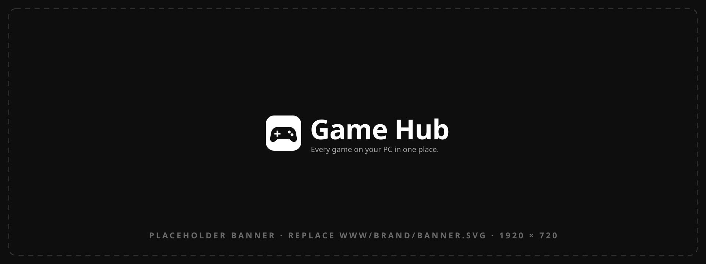
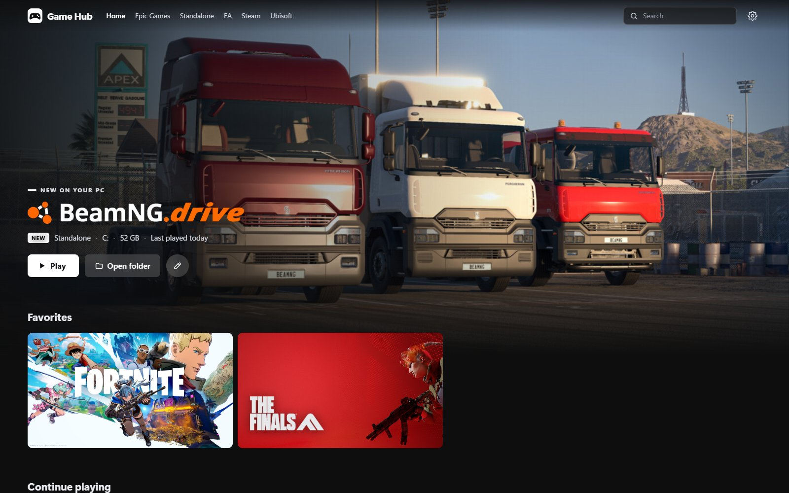
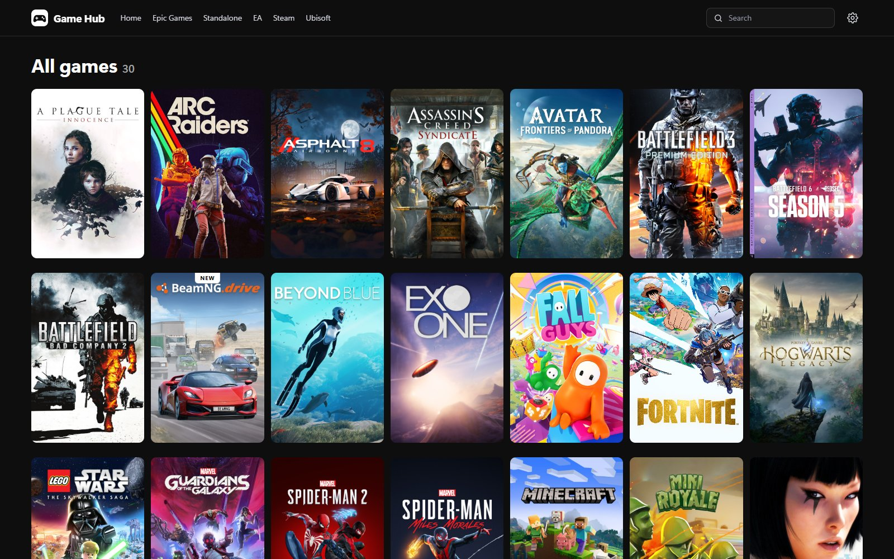

# Game Hub

**Every game on your PC in one place.** Game Hub is a Netflix-style launcher for Windows. It finds your Steam, Epic, EA, Ubisoft, GOG, Battle.net, Riot, Amazon, Rockstar, Xbox app and standalone games across all your drives, shows them with official cover art, and launches any of them with one click.

It runs entirely on your machine: a small PowerShell server and a web page at `http://localhost:8790`. There is nothing to install and no account to make. It sends no telemetry.




## Why

Games end up everywhere. Some come from Steam, some from Epic or the EA app. Others come from a launcher you reinstalled and that "forgot" its games, or from a folder on a second drive. Game Hub collects all of them into one library you can browse, search and launch, wherever each game lives and whichever launcher it belongs to.

## Features

- **A guided first run.** A setup page asks which drives to leave alone and where your games are, then scans. It can even write a prompt for your AI assistant to find your game folders, and checks every folder the AI suggests before adding it.
- **Finds your games automatically**
  - Reads Steam libraries, Epic launcher manifests, Ubisoft Connect, GOG Galaxy, Battle.net, Riot Client, Amazon Games and Rockstar installs, and the Xbox app (Microsoft Store and PC Game Pass).
  - Checks every folder you point it at.
  - Spots standalone games in Program Files by their engine files (Unreal, Unity, Steamworks, Bink, FMOD and more).
- **Launches each game the right way**
  - Through its launcher: `steam://`, the Epic launcher, `uplay://`, `battlenet://`, `amazon-games://`, the Riot Client, the Xbox app.
  - Directly from the executable for EA, standalone and unregistered games.
- **Netflix-style home page**
  - A featured billboard and a Favorites row of 16:9 cards. Point at a favorite and the billboard switches to it.
  - Continue playing, Most played, Recently added, and one row per launcher, ordered by how many games you have there.
- **Play time.** Hours played on every card, Steam's own history imported, and sorting by most played, recently played, recently added, size or name.
- **Official artwork** from Steam, Epic and the Microsoft Store. You can also search Steam, upload your own image, or drop one onto the cover.
- **Edit anything** with the pen on each card: name, executable, launch arguments, cover, background. You can also hide a game.
- **Add games manually** with the native Windows file picker.
- **Storage overview** per drive, plus a **Cleanup** panel for duplicate installs and leftovers you mark. Nothing is ever deleted for you.
- **Instant search.** Press `/` or `Ctrl+K`, type, then `Enter` to launch the first match.
- **Controller support.** Browse and launch with a DualSense, a DualShock 4 (also through DS4Windows) or an Xbox controller, with on-screen button hints and an on-screen keyboard. Hold View + Menu anywhere in Windows to bring Game Hub back.
- **DS4Windows rules per game.** Choose, game by game, whether DS4Windows stays on, turns off or switches profile while it runs. Game Hub writes the rules into DS4Windows for you, and suggests which games need DS4Windows from what each game understands by itself, how your controllers are connected, and your own answers. See [Controllers](docs/controllers.md#which-games-need-ds4windows).
- **Gets out of the way while you play.** As soon as the game's window opens, Game Hub minimizes so your keyboard, mouse and controller go straight to the game. It comes back when you quit. Both can be turned off.
- **Excluded drives** are never read. Use this for removable drives, backup disks or anything private.
- **Backups of your library.** A daily copy of your settings, game list, fixes, favorites, play time and custom covers, with one-click restore, self-repair after a crash, and a CSV of your games.
- **11 languages:** English, French, Spanish, Portuguese (Brazil), German, Russian, Simplified Chinese, Japanese, Korean, Polish and Turkish. The non-English ones were translated by an AI; [corrections are welcome](docs/translating.md).
- **Optional lock** to your Windows account, for PCs shared with other accounts.
- **No dependencies and no admin rights.** It needs only Windows PowerShell 5.1, which ships with Windows, and a browser.



## Quick start

1. **Get the files.** Clone the repository, or download `GameHub-<version>.zip` from the [latest release](https://github.com/izored/gamehub/releases/latest) and extract it. Any folder you can write to works, for example `%LOCALAPPDATA%\Programs\GameHub`: your settings and data are kept apart, in `%LOCALAPPDATA%\GameHub`. No administrator rights needed.
2. **Run the installer** from that folder (right-click an empty spot › **Open in Terminal**). [`install-shortcuts.ps1`](install-shortcuts.ps1) is short, so read it first if you like. It creates your data folder, removes Windows' downloaded-file tag from Game Hub's own files, and makes Desktop and Start menu shortcuts, plus a Startup entry so the server is ready at logon. Then it opens Game Hub. It downloads nothing and changes nothing else:

   ```powershell
   powershell -ExecutionPolicy Bypass -File .\install-shortcuts.ps1
   ```

3. **The setup page opens:**
   1. Tick the drives Game Hub must never read, such as a USB SSD or a backup disk. USB drives are ticked for you.
   2. Check the suggested game folders, add your own, or let an AI assistant find them.
   3. Pick a few options, then click **Scan my games**. Covers download right after; the page fills in by itself, usually within a minute or two.

**Want a guided setup?** Follow the step-by-step [setup guide](docs/setup-guide.md), or let an AI assistant do it with you: see [Set up with an AI assistant](docs/setup-with-ai.md). The playbook for assistants is in [AGENTS.md](AGENTS.md).

See [Installation](docs/installation.md) for details, updating and uninstalling.

## Requirements

| | |
|---|---|
| OS | Windows 10 or Windows 11 (Windows 10 version 2004 or later runs it with no VBScript) |
| Runtime | Windows PowerShell 5.1 (built in). PowerShell 7 is not needed. |
| Browser | Google Chrome, or Microsoft Edge (built into Windows): Game Hub opens in its own app window. Any modern browser works for browsing and launching. |
| Network | Only for downloading artwork, and for **Check my games** in Settings › Controllers. Scanning and launching work offline. |
| Rights | A normal user account. No administrator rights needed. |

## Supported launchers

| Launcher | Found through | Launched with |
|---|---|---|
| Steam | `libraryfolders.vdf` and app manifests | `steam://rungameid/<appid>` |
| Epic Games | Epic launcher manifests (`*.item`) | `com.epicgames.launcher://apps/...?action=launch` |
| Epic Games (not registered) | `.egstore` folder inside a game folder | The game's executable, with a warning on the card |
| EA app / Origin | `__Installer\installerdata.xml`, EA uninstall entries | The executable named by the EA installer data |
| Ubisoft Connect | Ubisoft launcher registry keys | `uplay://launch/<id>/0` |
| GOG Galaxy | GOG registry keys | The game's executable, with GOG's launch parameters |
| Battle.net | Blizzard uninstall entries | `battlenet://<game code>` (the executable for games without a code) |
| Riot Client | `RiotClientInstalls.json` and Riot's product settings | `RiotClientServices.exe --launch-product=<game>` |
| Amazon Games | Amazon Games uninstall entries | `amazon-games://play/<id>` |
| Rockstar Games Launcher | Rockstar registry keys | The game's executable |
| Xbox app (Microsoft Store, PC Game Pass) | Installed game packages (`MicrosoftGame.config`) | The app's own entry (`shell:AppsFolder\...`) |
| itch.io, DRM-free, emulators… | Your game folders and Program Files discovery | The game's executable |

Details, limits and how each executable is chosen: [docs/launchers.md](docs/launchers.md).

## Documentation

| Guide | What's in it |
|---|---|
| [Setup guide](docs/setup-guide.md) | Step by step, by hand: drives, folders, first scan, linking launcher games, duplicates, covers |
| [Set up with an AI assistant](docs/setup-with-ai.md) | Let Claude, ChatGPT, Copilot or another assistant walk you through setup ([playbook](AGENTS.md)) |
| [Installation](docs/installation.md) | Install, first run, run from the command line, update, uninstall |
| [Using Game Hub](docs/usage.md) | The setup page, home page, search, play time, editing and adding games, backups, settings |
| [Controllers](docs/controllers.md) | Xbox, DualSense and DualShock 4 in Game Hub and in your games: Steam Input, DS4Windows rules, which games need DS4Windows, double input |
| [Staying safe](docs/staying-safe.md) | Keeping a gaming PC safe, and what to do if a game or download seems to have done something |
| [Translating](docs/translating.md) | Fix a translation or add a language |
| [Configuration](docs/configuration.md) | `config.json`, `overrides.json` and the data files, field by field |
| [Launchers](docs/launchers.md) | How each launcher is detected and launched |
| [Artwork](docs/artwork.md) | Where covers come from, priority order, custom images |
| [Architecture](docs/architecture.md) | How the scanner, server and web app fit together |
| [HTTP API](docs/api.md) | Every endpoint the web app uses |
| [Troubleshooting](docs/troubleshooting.md) | Common problems and where the logs are |
| [Changelog](CHANGELOG.md) | Release history |

## Privacy

Game Hub has no telemetry, no analytics and no accounts. Your settings, library, favorites, play time and backups stay on your PC, in `%LOCALAPPDATA%\GameHub`, apart from the program ([where your data lives](docs/installation.md#where-your-data-lives)).

It contacts the internet only to download artwork and, when you press **Check my games**, to look up controller support:

- **Steam store API and image CDN.** It searches game titles, looks up Steam app ids and downloads images.
- **Epic's image CDN.** It downloads images whose URLs are already in the Epic launcher's local catalog cache.
- **Microsoft Store catalog.** It looks up the product ids of Xbox app games, and the ones you set yourself in `overrides.json`.
- **PCGamingWiki and Steam's store,** only when you press **Settings › Controllers › Check my games**. It looks up which controllers each game understands by itself.

Requests carry game names or store ids and a generic `GameHub` user agent, nothing else. See [Artwork](docs/artwork.md) and [Controllers](docs/controllers.md#which-games-need-ds4windows) for the exact calls.

Game Hub never talks to an AI service itself. The *find my game folders with an AI* helper only writes a prompt that **you** copy into the assistant of your choice; that assistant then sees your folder names.

## Security

The server listens only on `127.0.0.1` and accepts only requests addressed to `localhost`.

- **Write requests** need a custom header and are refused if they come from another origin, so other websites cannot trigger them.
- **Launching** works only for games in the catalog, by id. It never runs a path sent in a request.
- **Launcher links** must use an allowlisted URI scheme.
- **Optional lock:** on a PC shared with other Windows accounts, Game Hub can be locked to yours, so the others cannot launch or change anything.

See [SECURITY.md](SECURITY.md) for the full model and how to report a vulnerability.

## Contributing

Bug reports, launcher support and fixes are welcome. Read [CONTRIBUTING.md](CONTRIBUTING.md) first. The project deliberately has no build step and no dependencies, and the PowerShell scripts must stay compatible with Windows PowerShell 5.1.

## License

[MIT](LICENSE)

## Disclaimer

Game Hub is an independent project. It is not affiliated with or endorsed by Valve, Epic Games, Electronic Arts, Ubisoft, CD PROJEKT (GOG), Blizzard Entertainment, Riot Games, Amazon, Rockstar Games, Microsoft, Sony Interactive Entertainment, the DS4Windows project or any game publisher. Product names and logos are trademarks of their respective owners. The repository contains no game artwork. Artwork is downloaded to your own machine at runtime, for your personal use. The screenshots above show one user's library.
